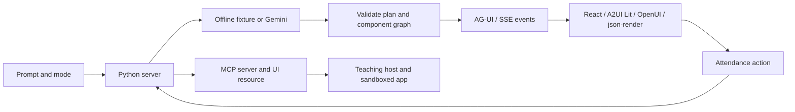

# Campus GenUI Lab — Assignment 4

An original campus event planner that demonstrates **A2UI, AG-UI, MCP Apps, json-render, OpenUI, and a local agent harness**. There are 23 progressive checkpoints and four selectable UI modes: static, declarative, open-ended, and mixed.

**The professor's repository is a learning reference, not this project's implementation.** The domain, application code, interface, adapters, and tests were written for this assignment with AI assistance. See [authorship and references](ATTRIBUTION.md).

## Code walkthrough videos

All code walkthrough videos are available in this [Google Drive folder](https://drive.google.com/drive/folders/1EWD1cj1WFl6VApxTw9hNxuUxkh-G0wfL?usp=sharing).

## Start here

Requirements: Python 3.11+ and Node.js 22+. Development was checked on Windows with Python 3.13 and Node 22.

```powershell
python -m venv .venv
.venv\Scripts\python.exe -m pip install -r requirements.txt
npm.cmd ci
npm.cmd run build
python run.py
```

Open **http://127.0.0.1:8000**. Choose a checkpoint in the sidebar and press **Run checkpoint**. The default source is **Offline fixture**, which makes no model API calls. On macOS/Linux use `.venv/bin/python` and `npm` instead of the Windows executable names.

The Python server serves the browser bundle and the MCP endpoint. You do not need to start a second frontend server. Keep the terminal open; press Ctrl+C to stop it. Use `python run.py --port 8010` if port 8000 is occupied.

## Use Gemini's free tier

Create a key for a **Free Tier** project in [Google AI Studio](https://aistudio.google.com/apikey). Keep billing disabled. Configure the key privately:

```powershell
powershell -ExecutionPolicy Bypass -File .\scripts\configure-gemini.ps1
python run.py doctor
```

Alternatively copy `.env.example` to `.env` and fill in `GEMINI_API_KEY`. Never record that file on video. `.env` is ignored by Git. `MODEL` must identify a model with available free quota in your project; the supplied initial value is `gemini-2.5-flash`. Change it if AI Studio no longer offers that model to you.

Refresh the page after saving the key. Select **Live Gemini** to use your own prompt. Most checkpoints use one request. Harness checkpoints may use up to three additional tool-loop requests. A quota error is shown explicitly; there is **no paid provider fallback and no automatic retry**. The program cannot verify your account's billing tier.

**Offline fixtures and live generation are different.** Offline prompts do not affect the fixed sample plan. A live run asks Gemini for structured content and validates it before rendering. The server delivers AG-UI/SSE events after Gemini's response completes, with a short teaching delay. This demonstrates incremental interface delivery; it does not measure live token-stream latency.

## What to demonstrate

| Part | Checkpoints | Focus | Main original source |
|---|---|---|---|
| 1. Foundations | 01.1–01.4 | Fixed cards → component map → sandboxed HTML → mixed UI | [representations.py](backend/representations.py), [components.jsx](web/components.jsx) |
| 2. AG-UI | 02.1–02.3 | Run lifecycle, shared state, tool-call events | [engine.py](backend/engine.py), [protocol.mjs](web/protocol.mjs) |
| 3. A2UI | 03.1–03.3 | Surfaces, data binding, A2UI carried in AG-UI custom events | [representations.py](backend/representations.py), [renderers.jsx](web/renderers.jsx) |
| 4. OpenUI | 04.1–04.4 | UI language, React library, byte comparison, custom component | [renderers.jsx](web/renderers.jsx) |
| 5. json-render | 05.1–05.3 | Zod catalog, incremental patches, actions, terminal target | [renderers.jsx](web/renderers.jsx), [representations.py](backend/representations.py) |
| 6. MCP Apps | 06.1–06.3 | Resource discovery, app/host bridge, nested custom region | [mcp_app.py](backend/mcp_app.py), [mcp-host.jsx](web/mcp-host.jsx), [mcp-app.html](web/mcp-app.html) |
| 7. Harness | 07.1–07.3 | Bounded tool loop, UI output, human interaction | [harness.py](backend/harness.py), [gemini.py](backend/gemini.py) |

Read [the 23-step walkthrough](docs/WALKTHROUGH.md) for the execution and explanation sequence. Read [the four-mode coverage matrix](docs/MODES.md) to explain which features belong to a protocol and which belong to the surrounding application.

## Verify and record

```powershell
python run.py test
npm.cmd test
python run.py terminal
```

For browser integration checks, leave `python run.py` running in one terminal, then run this in another. It uses an installed Google Chrome in headless mode and only offline fixtures:

```powershell
.venv\Scripts\python.exe scripts/check_browser.py
```

The browser checks include all 23 default checkpoints, the four modes across all seven sections, the MCP capacity-filter round trip, an attendance action, and mobile overflow. Screenshots and the detailed report are written to the ignored `evidence/browser/` folder. See [verification status](docs/VERIFICATION.md) for observed results and limits.

Optional live verification, after configuring your free-tier key:

```powershell
.venv\Scripts\python.exe scripts/check_live.py --lesson 01.1 --mode static
```

That command consumes Gemini quota and saves the generated result under ignored `artifacts/live/`. It never prints the key. The other modes can be checked with `--lesson 04.2 --mode declarative`, `--lesson 01.3 --mode open`, and `--lesson 07.3 --mode mixed`; the harness example may make up to four requests. `scripts/check_live_browser.py` replays these four saved outputs in the browser without additional API calls.

Record your own explanation and execution. Add your YouTube URLs to [VIDEOS.md](docs/VIDEOS.md). Suggested organization: seven videos, one per part, with chapters for each checkpoint. Your instructor determines whether that grouping satisfies “a video for each part.”

## Architecture



- `backend/domain.py`: sample venues and cost calculations.
- `backend/representations.py`: component contract, validation, format adapters, and terminal output.
- `backend/gemini.py`: native Gemini API calls; the key stays server-side.
- `backend/engine.py`: generation pipeline and official AG-UI event objects.
- `backend/main.py`: HTTP routes, bounded in-memory sessions, and MCP proxy.
- `web/`: original interface and official renderer integrations.
- `tests/`: original offline behavior and protocol checks.

## Scope and limitations

- A2UI targets the **v0.9** format supported by the pinned official Lit renderer. Our app translates a validated component graph into native Text/Column nodes. HTML lives in a **companion sandbox**, not in the A2UI basic catalog.
- OpenUI uses `@openuidev/react-lang`; json-render uses its official catalog, registry, and React renderer. The simple foundation renderer is our own teaching implementation.
- MCP calls use the official Python MCP SDK over Streamable HTTP at `/tools/mcp`. The browser host implements a deliberately small MCP Apps bridge: initialization, tool results, and one allowed tool. It is not a complete general-purpose MCP host, and third-party host compatibility must be verified separately.
- The local harness replaces the reference's TrueForge examples. No TrueForge installation or subscription is required, and no TrueForge integration is claimed.
- The byte comparison reports UTF-8 bytes for the same facts, not model tokens or inference speed.
- These are localhost teaching apps with in-memory state. They do not book venues, send messages, or make purchases. They are not production deployments.
- An HTML iframe uses an opaque origin and restrictive CSP. This is a teaching boundary, not a guarantee that arbitrary generated code is safe for production.

## Submission

All original code and documentation belong in this GitHub repository. The code walkthrough recordings are linked in [Code walkthrough videos](#code-walkthrough-videos). A GitHub repository URL provides access to the deliverables; a separate public deployment is not created by these setup commands. The assignment's locked submission window must be addressed with the instructor.
